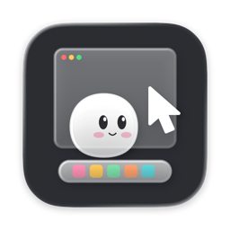

  

# Lite2D

macOS 原生菜单栏 Live2D 播放器。Swift + AppKit + OpenGL，支持多个同时显示、独立控制的模型实例。实际产物：`dist/Lite2D.app`。构建步骤见 [BUILD.md](BUILD.md)，验证与测量见 [TEST_REPORT.md](TEST_REPORT.md)。

## 下载

[Lite2D v0.1.1 · macOS ARM64](https://gitlab.com/stephenzeng/lite2d/-/releases/v0.1.1)。应用包不附模型或个人配置，当前为 ad-hoc 签名、未公证；自有代码和第三方组件的许可说明随包提供。

## 使用

运行 `.app`，点击菜单栏人物图标 → **添加模型…**，选择模型 JSON 或文件夹。同一路径可以重复添加，每个实例拥有独立 UUID、窗口、GL context、动画和设置。

每个实例菜单提供显示、编辑/穿透、视线追踪和平滑、暂停、循环动作组、动作/表情、30/60 FPS、放大/缩小、置前、重命名、更换、复制和移除；可撤销最近一次移除。没有资源的动作或表情不会凭空生成。

编辑模式下拖动窗口、滚轮缩放；切换编辑对象会让前一个实例回到点击穿透。穿透和非焦点状态下仍采样全局鼠标。全部隐藏是临时覆盖，恢复时保留各实例自己的显示偏好。

## 显示器绑定

每个实例绑定一块显示器，保存显示器 UUID 和以该屏左下角为原点的 point 偏移。添加模型默认绑定主显示器；**绑定显示器**子菜单可明确选择另一块屏幕，拖动完成也会更新所属屏幕和屏内位置。

目标显示器断开时，该实例直接隐藏、停止绘制，保留位置和显示偏好；不自动搬到主屏。重新连接后恢复到同一块屏幕的原位置，显式隐藏的实例继续隐藏。全局恢复、置前和复制不会把离线绑定的角色带到其他屏幕。菜单的**重置在绑定屏内的位置**保持原绑定；想换屏需显式重新绑定。

配置保存于 `~/Library/Application Support/Lite2D/settings.json`，退出保存、重启恢复。schemaVersion 3 会迁移旧的全局位置；若无法判断原显示器，则保持未绑定/隐藏，等待菜单选择。更换转接器或系统重新分配显示器 UUID 后可能需要重新绑定，应用不会仅凭同名显示器猜测。

## 模型与限制

Cubism Native R5/Core 用于 `.model3.json` + `.moc3`。旧版 `.moc` 使用进程内 JavaScriptCore 与原生 OpenGL，未引入浏览器、WebView、Unity 或额外常驻服务。旧版物理、姿势、表情及 Live2DViewerEX 专用控制器未实现。不能通过改后缀转换模型版本。

从你有权使用的模型目录选择入口 JSON；模型、专有运行库和 Core 不随源码提交。第三方打包格式需先准备为受支持的模型目录。

当前实测为 M3 Pro / macOS 27.2，部署目标 macOS 14+、ARM64。OpenGL 已弃用。Stage Manager、跨 1×/2× DPI 和物理热插拔尚未完成实机验收；Space/全屏表现未作完整实机验收，不承诺所有系统场景强制置顶。

## 常见问题

- 角色未出现：检查实例显示勾选与全局隐藏状态，再看绑定显示器是否离线/未绑定；可从菜单显式换屏。
- 模型报错：只影响对应实例，检查必要二进制/纹理路径；更换失败保留旧实例，其他实例继续运行。
- 角色太大或位置不合适：在实例菜单缩小或重置绑定屏内位置，不需要 Dock 图标。
- 重建：使用 BUILD.md 的脚本；测试采用隔离配置，不覆盖日常布局。

本项目自有代码采用 [MIT License](LICENSE)，第三方依赖及其衍生部分不因此改为 MIT。Live2D 对可扩展应用另有发布许可要求；源码公开也不能当作取得该许可的证明，公开仓库或发布 `.app` 前应核实适用要求。见 [第三方说明](docs/THIRD_PARTY_NOTICES.md) 和 [公开前审计](docs/PUBLIC_RELEASE_AUDIT.md)。

## 登录时自动启动

菜单栏 → **登录时自动启动**，勾选后由 macOS 在当前用户登录时启动 Lite2D，并恢复已保存的模型、显示器绑定和布局；再次点击关闭。系统维护登录项状态，应用每次打开菜单都会读取实际状态。若显示“等待系统允许”，使用下方入口前往系统设置 → 通用 → 登录项允许 Lite2D。

建议先把 `.app` 放在固定位置（例如 `/Applications/Lite2D.app`）再开启；移动或重新安装后可关闭再开启以更新登记。此功能使用 `SMAppService.mainApp`，不增加辅助进程或 LaunchAgent。属于用户登录后启动，不是在登录前运行。
